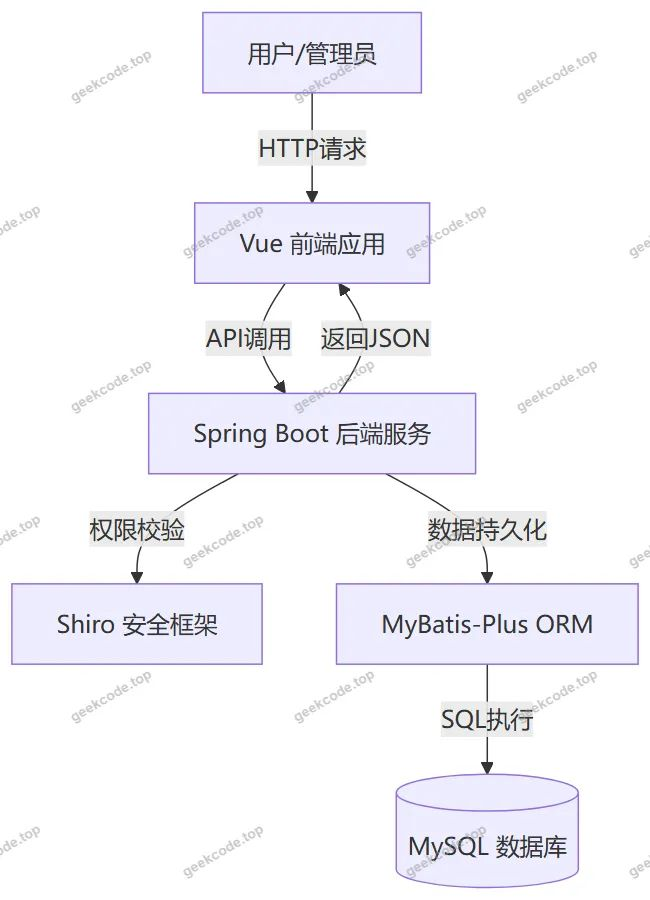
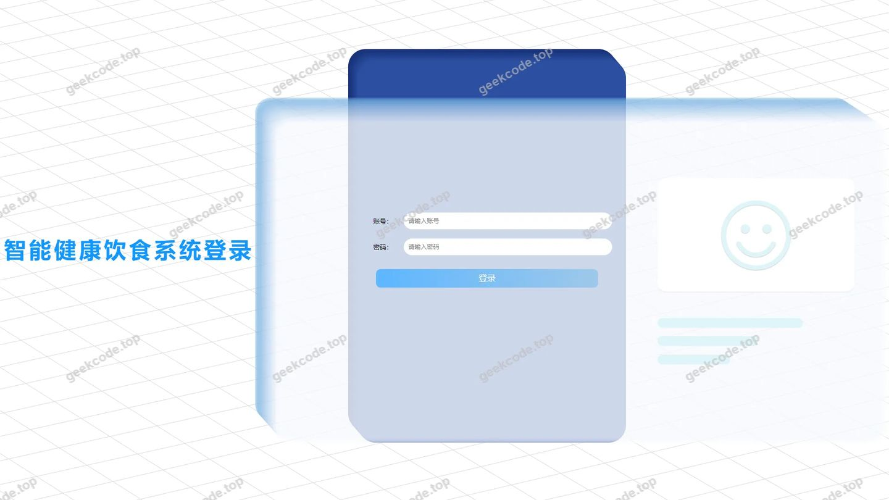
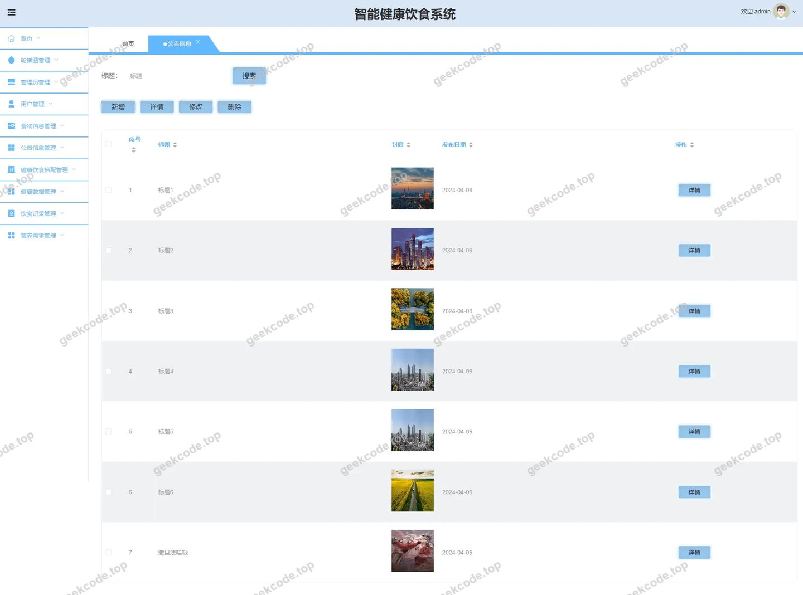
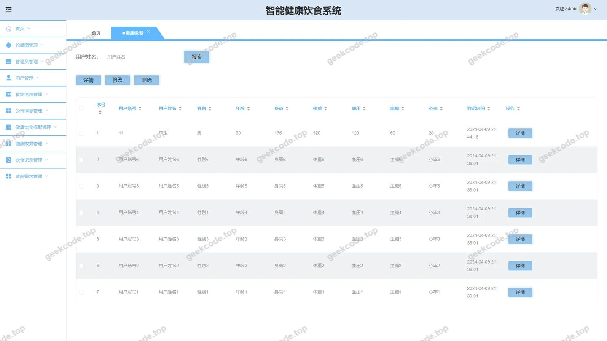
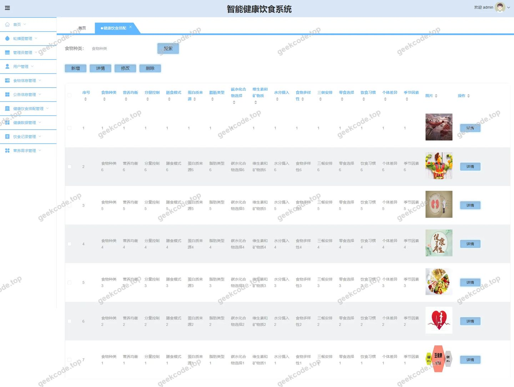
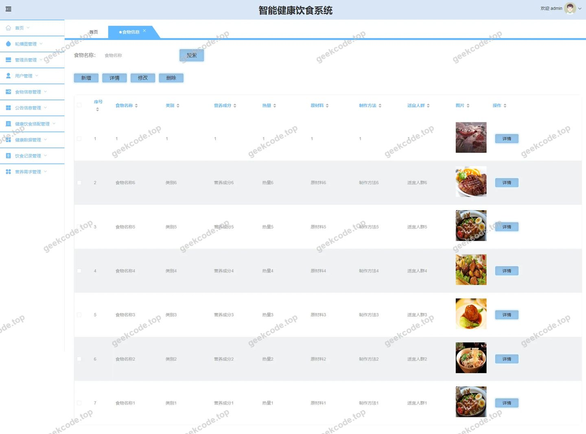
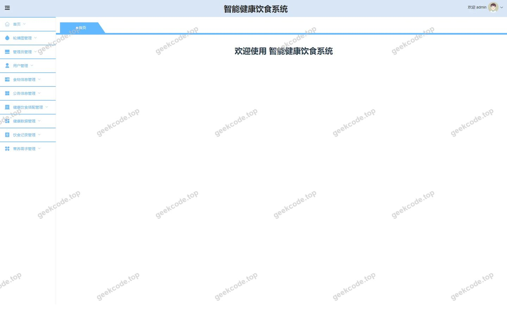
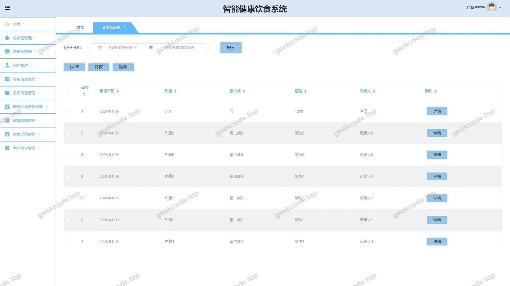
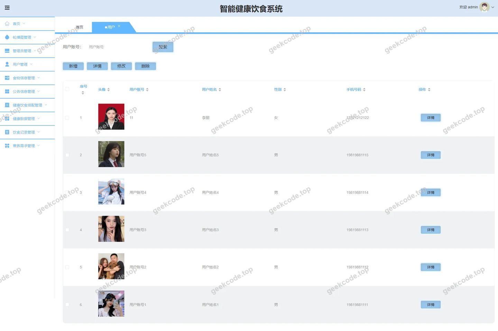

# [springboot]智能健康饮食系统

> 🎓 **计算机毕业设计 · [springboot]智能健康饮食系统**
>
> 本仓库只放**项目介绍 + 运行截图**（截图是站点带水印的原图，存在仓库 `images/` 里）。
>
> 👉 **完整可运行源码 / 数据库脚本 / 部署文档：[点我获取](https://geekcode.top/archives/springboot-%E6%99%BA%E8%83%BD%E5%81%A5%E5%BA%B7%E9%A5%AE%E9%A3%9F%E7%B3%BB%E7%BB%9F?utm_source=github)**
>
> 💬 咨询微信：**ir9372**　|　🌐 更多项目：[极客代码 geekcode.top](https://geekcode.top/?utm_source=github)
>
> 📌 项目详情页：<https://geekcode.top/archives/springboot-%E6%99%BA%E8%83%BD%E5%81%A5%E5%BA%B7%E9%A5%AE%E9%A3%9F%E7%B3%BB%E7%BB%9F?utm_source=github>

<table><td width="230" align="center"> <b>扫码加微信 ir9372</b></td><td valign="middle">📦 源码 = 项目介绍 + 全部运行截图 + 数据库 + 部署文档 👉 点上方任意截图，直接跳到 <b>极客代码 geekcode.top</b> 详情页</td></table>

---

<h1>[springboot]智能健康饮食系统</h1>
<h2>项目概述</h2>

智能健康饮食系统旨在通过数字化手段解决现代人群在饮食管理中的信息不对称与个性化需求缺失问题。系统基于 Spring Boot 后端框架与 Vue 前端技术构建，采用前后端分离架构（vue-integrated），实现了从食物信息管理、用户健康数据记录到科学饮食搭配推荐的全流程闭环服务。核心功能涵盖食物库维护、公告发布、用户注册登录、个人健康档案建立及饮食记录追踪等模块。该系统适用于关注自身健康状况、需要科学指导日常饮食的普通用户群体，同时也为管理员提供了高效的数据管理与内容运营工具。通过整合 MyBatis-Plus 数据持久层与 Shiro 安全框架，确保了系统的高并发处理能力与数据安全，为用户提供便捷、专业的健康管理体验。

<h2>技术架构</h2>

本项目采用经典的前后端分离架构，整体技术栈设计兼顾开发效率、运行性能与安全性。

<strong>1. 后端架构</strong>
后端核心基于 <strong>Spring Boot</strong> 框架构建，利用其自动配置特性快速搭建 Web 应用基础环境。数据访问层采用 <strong>MyBatis-Plus</strong> 作为 ORM 框架，继承自 MyBatis，提供了通用的 CRUD 操作接口，极大减少了样板代码，提升了数据库交互效率。安全认证与授权模块集成 <strong>Apache Shiro</strong>，负责处理用户会话管理、权限校验及身份验证，确保只有经过授权的用户才能访问特定资源。数据库选用 <strong>MySQL</strong>，通过 <code>mysql-connector-java</code> 驱动进行连接，满足结构化数据存储需求。

<strong>2. 前端架构</strong>
前端采用 <strong>Vue.js</strong> 生态体系，结合路由管理实现单页面应用（SPA）的动态加载。根据项目类型 <code>vue-integrated</code>，前端代码与后端工程深度集成或独立部署后通过 API 网关通信。界面组件化开发使得前台展示页与后台管理页逻辑清晰，便于维护。

<strong>3. 核心技术选型理由</strong>

<ul>
<li><strong>Spring Boot</strong>: 简化配置，内置 Tomcat，适合快速迭代开发。</li>
<li><strong>MyBatis-Plus</strong>: 相比原生 MyBatis，提供更强大的条件构造器和分页插件，适合复杂查询场景。</li>
<li><strong>Shiro</strong>: 轻量级且功能完备的安全框架，易于与 Spring 集成，支持细粒度权限控制。</li>
<li><strong>Vue</strong>: 响应式数据绑定机制，提升用户体验，组件复用性强。</li>
</ul>

<h2>功能模块</h2>

系统分为前台用户端和后台管理端两大主要部分，各模块功能明确，覆盖饮食健康管理的各个环节。

<h3>前台用户端</h3>

前台面向注册用户，提供个性化的健康数据录入与信息查询服务。

<ul>
<li><strong>首页展示 (<code>/index</code>)</strong>: 系统入口，聚合关键信息导航。</li>
<li><strong>用户中心 (<code>/index/yonghuCenter</code>)</strong>: 用户个人信息查看与管理入口。</li>
<li><strong>用户信息管理</strong>:</li>
<li>列表 (<code>/index/yonghuList</code>)：浏览其他公开用户信息（视具体业务逻辑而定）。</li>
<li>详情 (<code>/index/yonghuDetail</code>)：查看用户详细信息。</li>
<li>新增 (<code>/index/yonghuAdd</code>)：完善个人资料。</li>
<li>注册 (<code>/yonghuRegister</code>)：新用户账号创建。</li>
<li><strong>食物信息浏览</strong>:</li>
<li>列表 (<code>/index/shiwuxinxiList</code>)：查看平台收录的食物基本信息。</li>
<li>详情 (<code>/index/shiwuxinxiDetail</code>)：查看特定食物的营养成分、类别等详细数据。</li>
<li>新增 (<code>/index/shiwuxinxiAdd</code>)：允许用户上传或添加新的食物条目（需权限支持）。</li>
<li><strong>公告信息</strong>:</li>
<li>列表 (<code>/index/gonggaoxinxiList</code>)：查看平台发布的健康资讯或通知。</li>
<li>详情 (<code>/index/gonggaoxinxiDetail</code>)：阅读公告具体内容。</li>
<li>新增 (<code>/index/gonggaoxinxiAdd</code>)：提交公告申请或草稿（视业务流程而定）。</li>
<li><strong>健康饮食搭配</strong>:</li>
<li>列表 (<code>/index/jiankangyinshidapeiList</code>)：浏览推荐的食谱组合。</li>
<li>详情 (<code>/index/jiankangyinshidapeiDetail</code>)：查看搭配的具体食材与建议。</li>
<li>新增 (<code>/index/jiankangyinshidapeiAdd</code>)：创建自定义的饮食搭配方案。</li>
<li><strong>健康数据记录</strong>:</li>
<li>列表 (<code>/index/jiankangshujuList</code>)：查看历史健康指标（如体重、血压等）。</li>
<li>详情 (<code>/index/jiankangshujuDetail</code>)：分析单次健康数据记录。</li>
<li>新增 (<code>/index/jiankangshujuAdd</code>)：录入新的身体检查数据。</li>
<li><strong>饮食记录</strong>:</li>
<li>列表 (<code>/index/yinshijiluList</code>)：回顾每日进食情况。</li>
<li>详情 (<code>/index/yinshijiluDetail</code>)：查看某次饮食的详细构成。</li>
<li>新增 (<code>/index/yinshijiluAdd</code>)：记录当餐摄入的食物种类与分量。</li>
<li><strong>营养需求</strong>:</li>
<li>列表 (<code>/index/yingyangxuqiuList</code>)：查看不同人群的营养标准建议。</li>
<li>详情 (<code>/index/yingyangxuqiuDetail</code>)：了解特定营养素的需求量。</li>
<li>新增 (<code>/index/yingyangxuqiuAdd</code>)：设定个人的营养目标或特殊需求。</li>
</ul>
<h3>后台管理端</h3>

后台面向管理员，提供全局数据监控、内容审核与系统配置功能。

<ul>
<li><strong>系统首页</strong>: 管理员登录后的默认工作台，通常包含数据统计概览。</li>
<li><strong>食物信息管理 (<code>/shiwuxinxi</code>)</strong>: 对平台所有食物数据进行增删改查，维护基础数据库。</li>
<li><strong>用户管理 (<code>/yonghu</code>)</strong>: 查看注册用户列表，管理用户状态，重置密码或删除违规账号。</li>
<li><strong>健康数据管理 (<code>/jiankangshuju</code>)</strong>: 审核或导出用户的健康监测数据，用于统计分析。</li>
<li><strong>饮食记录管理 (<code>/yinshijilu</code>)</strong>: 查看全平台的用户饮食日志，辅助研究饮食习惯。</li>
<li><strong>健康饮食搭配管理 (<code>/jiankangyinshidapei</code>)</strong>: 编辑官方推荐的食谱，审核用户提交的搭配方案。</li>
<li><strong>公告信息管理 (<code>/gonggaoxinxi</code>)</strong>: 发布、编辑或删除平台通知公告，控制前台可见性。</li>
<li><strong>系统配置 (<code>/config</code>)</strong>: 修改站点名称、Logo、轮播图等全局参数。</li>
<li><strong>用户账户管理 (<code>/users</code>)</strong>: 管理系统内部管理员账号，分配角色权限。</li>
<li><strong>营养需求管理 (<code>/yingyangxuqiu</code>)</strong>: 维护标准的营养学参考数据表。</li>
</ul>
<h2>用户角色与权限</h2>

根据系统架构及路由设计，主要存在两种角色：<strong>普通用户</strong>和<strong>系统管理员</strong>。

<h3>1. 普通用户 (User)</h3>

普通用户是系统的主要服务对象，拥有个人数据的读写权限及公共信息的只读权限。

<ul>
<li><strong>认证与注册</strong>: 可通过 <code>/yonghuRegister</code> 进行注册，登录后进入个人中心。</li>
<li><strong>个人数据管理</strong>:</li>
<li><strong>健康数据</strong>: 可新增 (<code>/index/jiankangshujuAdd</code>)、查看自己的历史记录 (<code>/index/jiankangshujuList</code>, <code>/index/jiankangshujuDetail</code>)。</li>
<li><strong>饮食记录</strong>: 可记录每日饮食 (<code>/index/yinshijiluAdd</code>)，并查看过往记录 (<code>/index/yinshijiluList</code>, <code>/index/yinshijiluDetail</code>)。</li>
<li><strong>营养需求</strong>: 可设定个人营养目标 (<code>/index/yingyangxuqiuAdd</code>)，查看相关标准 (<code>/index/yingyangxuqiuList</code>, <code>/index/yingyangxuqiuDetail</code>)。</li>
<li><strong>个人信息</strong>: 可查看和编辑自己的基本资料 (<code>/index/yonghuCenter</code>, <code>/index/yonghuAdd</code>)。</li>
<li><strong>公共信息访问</strong>:</li>
<li><strong>食物信息</strong>: 可浏览食物库 (<code>/index/shiwuxinxiList</code>, <code>/index/shiwuxinxiDetail</code>)。根据路由存在 <code>/index/shiwuxinxiAdd</code>，推测用户可能具备贡献新食物数据的权限，但通常此类操作需管理员审核。</li>
<li><strong>公告信息</strong>: 可阅读平台公告 (<code>/index/gonggaoxinxiList</code>, <code>/index/gonggaoxinxiDetail</code>)。</li>
<li><strong>饮食搭配</strong>: 可浏览推荐食谱 (<code>/index/jiankangyinshidapeiList</code>, <code>/index/jiankangyinshidapeiDetail</code>)。同样存在 <code>/index/jiankangyinshidapeiAdd</code>，表明用户可创建自定义搭配方案供自己使用或分享。</li>
</ul>
<h3>2. 系统管理员 (Admin)</h3>

管理员拥有最高权限，负责系统的整体运营、数据维护和安全管控。

<ul>
<li><strong>后台登录</strong>: 通过专用后台登录页进入管理系统。</li>
<li><strong>全量数据管理</strong>:</li>
<li><strong>用户管理</strong>: 访问 <code>/yonghu</code> 模块，查看所有用户信息，执行禁用、删除等操作；访问 <code>/users</code> 模块管理管理员账号。</li>
<li><strong>内容管理</strong>: 全面掌控 <code>/shiwuxinxi</code> (食物)、<code>/gonggaoxinxi</code> (公告)、<code>/jiankangyinshidapei</code> (搭配)、<code>/yingyangxuqiu</code> (营养需求) 等模块的增删改查，确保数据准确性与合规性。</li>
<li><strong>数据审计</strong>: 访问 <code>/jiankangshuju</code> 和 <code>/yinshijilu</code>，查看全平台用户的行为数据，用于宏观分析或异常检测。</li>
<li><strong>系统配置</strong>: 通过 <code>/config</code> 模块调整系统全局参数，影响前台展示效果。</li>
</ul>

<em>(注：根据现有源码路由结构，未检测到教师、学生等细分角色，故仅列出上述两类核心角色。)</em>

<h2>项目特色与创新点</h2>
<ol>
<li>
<strong>数据驱动的个性化健康管理</strong>:
   系统不仅仅是一个静态的信息展示平台，而是通过“健康数据”、“饮食记录”与“营养需求”三个维度的联动，构建了用户个人的数字健康画像。用户可以根据自身的营养需求设定，结合每日饮食记录，形成闭环的自我监控体系。

</li>
<li>
<strong>标准化的饮食搭配知识库</strong>:
   引入“健康饮食搭配”模块，将复杂的营养学知识转化为可视化的食谱方案。管理员可维护专业搭配数据，用户亦可参与创建，形成了“专家推荐+用户共创”的内容生态，提高了饮食建议的科学性与多样性。

</li>
<li>
<strong>灵活的角色权限体系</strong>:
   基于 Shiro 框架实现了细粒度的权限控制。前台用户专注于个人数据的录入与查阅，后台管理员则侧重于全局内容的治理与数据分析。这种分离设计既保证了用户隐私（如健康数据不被随意泄露），又赋予了管理员高效的内容运营能力。

</li>
<li>
<strong>模块化与可扩展性</strong>:
   采用 MyBatis-Plus 和 Spring Boot 的微服务友好型架构，各个功能模块（如食物、公告、用户）相对独立。若未来需要增加“运动记录”或“医疗咨询”等新模块，只需扩展相应的 Controller 和 Service 层，无需重构核心框架，具备良好的可维护性。

</li>
</ol>
<h2>部署环境</h2>

为确保智能健康饮食系统正常运行，服务器及开发环境需满足以下软件版本要求：

<ul>
<li><strong>操作系统</strong>: Windows Server / Linux (CentOS, Ubuntu) / macOS</li>
<li><strong>Java 运行环境</strong>: JDK 1.8 或以上版本（推荐 JDK 1.8 以兼容 Spring Boot 2.x 常见版本）</li>
<li><strong>数据库</strong>: MySQL 5.7 或 MySQL 8.0</li>
<li><strong>Web 容器</strong>: 内置于 Spring Boot 的 Apache Tomcat（生产环境建议使用 Nginx 反向代理）</li>
<li><strong>前端构建环境</strong>: Node.js (建议 LTS 版本，如 v14 或 v16+)，npm 或 yarn 包管理器</li>
<li><strong>开发工具</strong>: IntelliJ IDEA (后端), VS Code (前端), Navicat (数据库管理)</li>
<li><strong>依赖库</strong>: Maven (用于管理 Java 依赖包)</li>
</ul>

<strong>部署步骤简述</strong>:

<ol>
<li>安装 JDK 并配置环境变量。</li>
<li>安装 MySQL 数据库，创建对应 Schema 并导入初始化 SQL 脚本。</li>
<li>修改 Spring Boot 配置文件 (<code>application.yml</code> 或 <code>properties</code>)，指向正确的数据库地址、用户名和密码。</li>
<li>使用 Maven 打包后端项目生成 <code>.jar</code> 文件，并通过 <code>java -jar</code> 命令启动。</li>
<li>在前端项目中执行 <code>npm install</code> 安装依赖，随后执行 <code>npm run build</code> 生成静态资源文件。</li>
<li>将生成的前端静态文件部署至 Nginx 或 Spring Boot 的静态资源目录中，配置反向代理规则以转发 API 请求至后端服务端口。</li>
</ol>
<h2>五、技术特性</h2>
<ul>
<li>前后端集成部署，前端资源打包至后端 static 目录</li>
<li>使用 MyBatis-Plus 简化数据访问层开发</li>
<li>集成 Shiro 权限框架实现角色权限控制</li>
</ul>
<h2>六、功能模块截图</h2>
<h3>前台用户端</h3>
<h4>前台-首页</h4>

<h4>前台-登录</h4>

<h4>前台-用户注册</h4>

<h3>后台管理端</h3>
<h4>后台-登录页</h4>

<h4>后台-公告信息</h4>

<h4>后台-健康数据</h4>

<h4>后台-健康饮食搭配</h4>

<h4>后台-食物信息</h4>

<h4>页面-首页</h4>

<h4>后台-饮食记录</h4>

<h4>后台-用户</h4>

---

## 获取完整源码

| 项目 | 说明 |
| --- | --- |
| 项目名 | [springboot]智能健康饮食系统 |
| 运行截图 | 本文 12 张（站点带水印原图，仓库 `images/` 目录） |
| 完整源码 | [https://geekcode.top/archives/springboot-%E6%99%BA%E8%83%BD%E5%81%A5%E5%BA%B7%E9%A5%AE%E9%A3%9F%E7%B3%BB%E7%BB%9F?utm_source=github](https://geekcode.top/archives/springboot-%E6%99%BA%E8%83%BD%E5%81%A5%E5%BA%B7%E9%A5%AE%E9%A3%9F%E7%B3%BB%E7%BB%9F?utm_source=github) |
| 咨询微信 | **ir9372**（备注：jingpin-yuanma） |
| 更多项目 | [极客代码 geekcode.top](https://geekcode.top/?utm_source=github) |

> 需要源码、部署、改配置、跑不起来等问题，加微信 ir9372 沟通，说明项目名即可。
